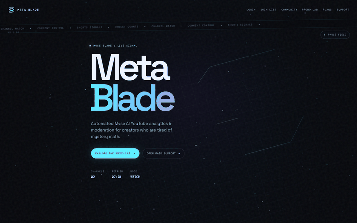
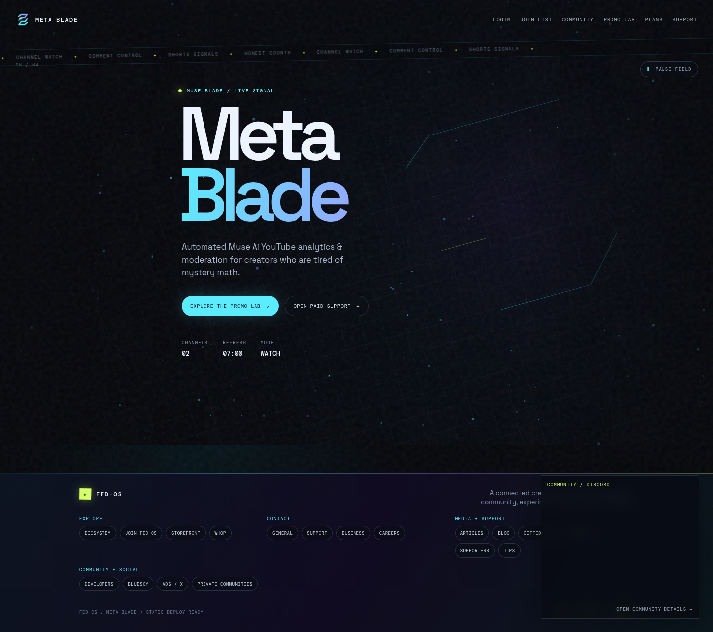
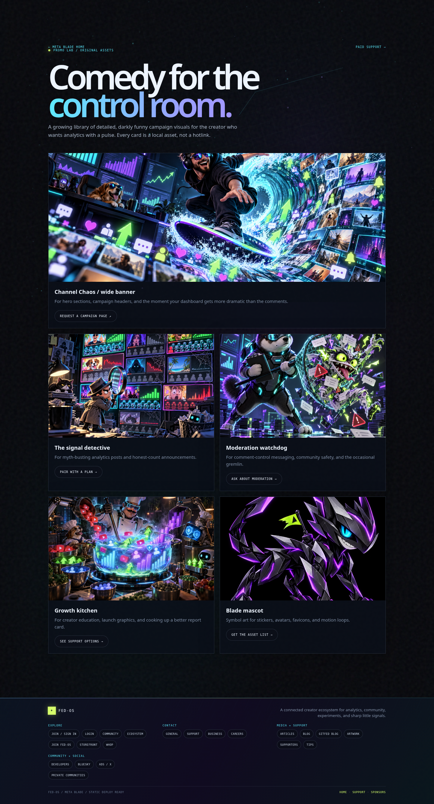
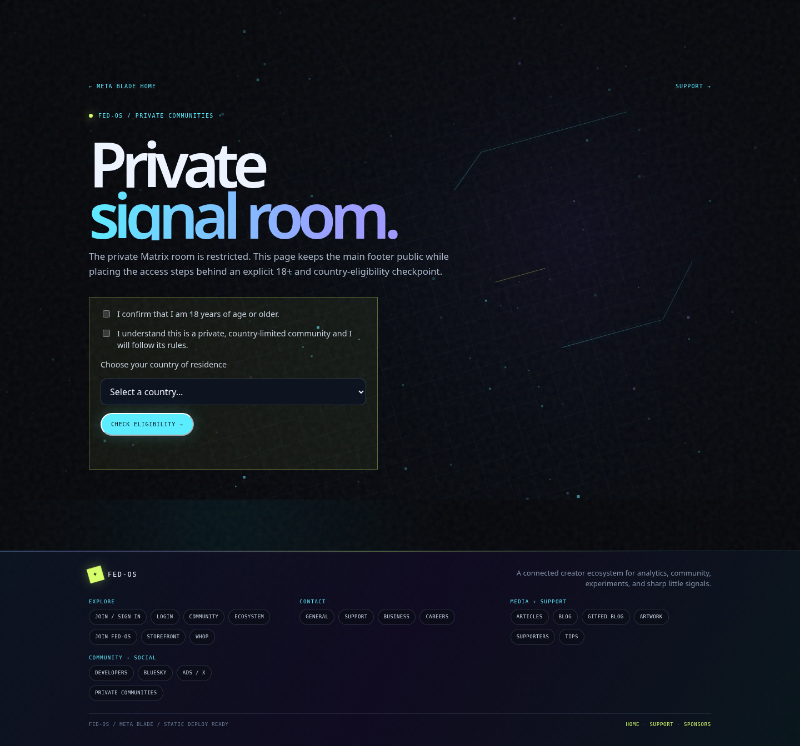

# Meta Blade — Signal Lattice

A standalone dark animated front end for **Meta Blade — Automated Muse Ai YouTube analytics & moderation**.

[](LICENSE)

Meta Blade is currently a static HTML/CSS/JavaScript experience: an eye-catching non-orbital signal-lattice landing page, promotion gallery, gated support/payment routes, community flows, and Supabase-powered login/join pages. It does not pretend to be a live analytics backend; the package is the front-end layer and route structure.

## Why this exists

Creator tooling often feels either visually flat or overloaded with mystery math. This project gives the interface a recognizable visual language while keeping important paths explicit: internal navigation stays on local HTML pages, paid actions are separated into their own lanes, restricted community links are gated, and the public footer stays readable.

The visual system is intentionally different from orbital or space-themed dashboards. It uses angular data planes, diagonal telemetry streams, sparse particles, scanline movement, pointer response, a looping ticker, and cyan/violet/acid accents. There are no planets, orbit rings, concentric tracks, or orbital motifs.

## See it work

### 30-second demo



The GIF above is captured from the actual running `index.html` page. Move the pointer across the page to shift the light field, then use the header links or the animated FED-OS footer to open the other real HTML routes.

### Real screenshots







## Quick start

No dependency installation is required for the static demo.

```bash
# optional source check
npm run check

# serve the real application
python3 -m http.server 4173
```

Open <http://localhost:4173> and start at `index.html`.

The fastest useful routes are:

- [Animated home](index.html)
- [Promo Lab](pages/promotions.html)
- [Plans and support lanes](pages/pricing.html)
- [Login](pages/login.html)
- [Join Email List](pages/join.html)
- [Community invite](pages/invite.html)
- [Private Communities gate](pages/private-communities.html)

## What is included

- `index.html` — animated home page with a symbol favicon, infinite ticker, pointer-reactive canvas field, Discord dock, header navigation, and FED-OS footer.
- `src/app.js` — canvas signal-lattice animation, angular signature, scanline field, particles, pause/play control, and pointer response.
- `src/styles.css` — shared responsive theme, motion effects, footer system, payment cards, promotion cards, and gated-form styling.
- `pages/promotions.html` — original comedic promotional art gallery.
- `pages/pricing.html` — separate subscription, donation, sponsorship, and free-community lanes.
- `pages/age-gate.html` and `pages/payment.html` — age checkpoint and provider-specific payment routes.
- `pages/sponsors.html` — responsive GitHub Sponsors iframe card.
- `pages/login.html` — Supabase login button/modal with sign-in, sign-up, password reset, session state, and logout.
- `pages/join.html` — Supabase Join Email List modal with typewriter prompts, sign-in toggle, password reset, session state, and logout.
- `pages/invite.html` — animated FedPromptly community invite button and Discord-style modal card.
- `pages/discord.html` and `pages/nsfw-request.html` — Discord server buttons with an HTML-only 18+ instruction flow that does not expose the restricted invite.
- `pages/private-communities.html` — 18+ and country-eligibility gate for the restricted Matrix room.
- `assets/` — local symbol SVG, promotional PNGs, mascot GIF, and real demo captures.
- `routes.json` — route map and static deployment notes.

## Payments and external services

The package separates provider lanes instead of mixing them together:

- Subscription: PayPal subscription and Stripe buy button.
- Donation: Buy Me a Coffee and NOWPayments.
- Sponsorship: GitHub Sponsors.
- Community: Discord/support routes.
- Auth and email list: the supplied Supabase project configuration in `pages/login.html` and `pages/join.html`.

Ko-fi is intentionally absent. Internal navigation uses local HTML files. External provider buttons intentionally leave the static site because checkout, authentication, or community access is handled by those providers. This package does not claim to be the payment, auth, analytics, or moderation backend.

## Optional community button

The following is a reusable button example supplied for an Echoed server. It is not part of the Meta Blade core flow and has not been presented as a live project integration:

```html
<style>
  .btn {
    display: inline-block;
    padding: 12px 24px;
    background: #5865F2;
    color: #fff;
    text-decoration: none;
    border-radius: 8px;
    font-weight: 600;
    font-family: Arial, sans-serif;
  }
  .btn:hover {
    background: #4752C4;
  }
</style>

<a class="btn" href="https://preview.echoed.gg/server/65dd48216ed48ac1856e"
   target="_blank" rel="noopener noreferrer">
  Join Echoed Server
</a>
```

## GitHub Pages

This repository is static and can be published from its root directory:

1. Push the contents of this folder to a GitHub repository.
2. Open **Settings → Pages**.
3. Select the desired branch and the repository root as the source.
4. Preserve the relative folder structure; `index.html` must remain at the published root.

No GitHub Pages workflow is included in this package, and no live GitHub Pages URL is currently configured.

## Cloudflare Pages

Connect the repository as a static site with:

- Build command: none
- Output directory: project root
- Framework preset: none / static HTML

A Worker is not required for the current package. No Cloudflare deployment URL is currently configured.

## Development notes

- The visual background is code-driven; there is no orbital visual layer.
- `prefers-reduced-motion` disables or reduces the looping effects where supported.
- Demo screenshots and the GIF in `assets/demo/` were captured from the real local app with Chromium; they are not mockups.
- The footer intentionally omits Facebook and the personal Substack link, and keeps the Matrix room behind the local private-community gate.
- Keep payment keys, auth configuration, and provider destinations under review before production deployment.

## License

MIT. See [LICENSE](LICENSE).
